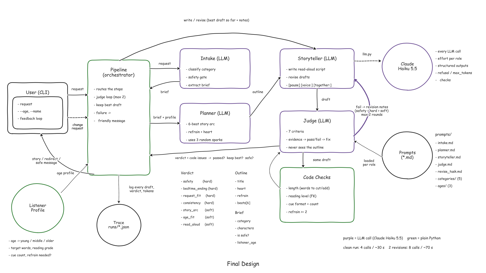
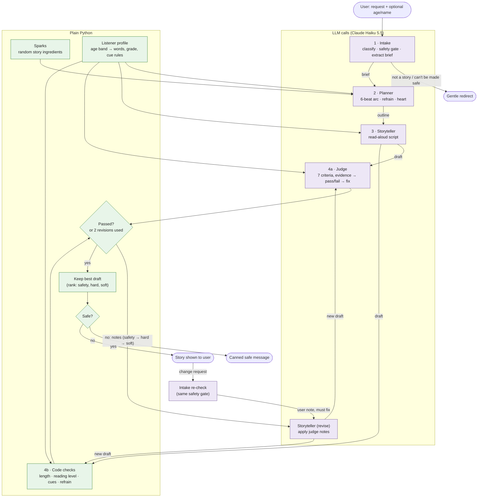

# Bedtime Story Teller

A bedtime story generator for children aged 5 to 10. It turns any request into a planned, judged story, written as a **read-aloud script** for the parent and **tuned to the child's age**.

Built for the Hippocratic AI take-home ([original brief](docs/ASSIGNMENT.md)). As the assignment email instructed, every call uses **Claude Haiku 5.5** (`claude-haiku-5-5`) instead of GPT-3.5 Turbo.

```text
$ python main.py "a funny story about a dinosaur who wants to be a ballerina" --age 6 --name Maya
```

## Quick start

Python 3.10+.

```bash
python -m venv .venv && source .venv/bin/activate
pip install -r requirements.txt
cp .env.example .env          # add your ANTHROPIC_API_KEY

python main.py                                  # asks what story you want
python main.py "a shy dragon who loves baking" --age 6 --name Maya
python main.py "..." --plain                    # hide the read-aloud cues
python main.py "..." -v                         # show outline, judge results and revisions
python main.py "..." --baseline                 # the original single call, for comparison

pytest                                          # 42 tests, scripted fake model, no API key needed
python -m evals.run_eval                        # pipeline vs. baseline, pairwise judge (uses the API)
```

After each story you can ask for changes ("make Bob sillier", "shorter please"). Press Enter to finish.

## How it works



The same flow as a Mermaid diagram, showing the prompts and the interactions between the user, intake, planner, storyteller, judge and code checks (purple = LLM calls, green = plain Python):



Each box is **one model call with its own prompt** ([storyteller/prompts/](storyteller/prompts/)). Python decides what runs next ([pipeline.py](storyteller/pipeline.py)). A clean run takes 4 calls; with both revision rounds it takes 8 (plus one retry if a structured output comes back unusable). Every turn writes a JSON trace to `runs/` with each draft, verdict, revision note, token count and timing.

## Design decisions

**1. Small, single-purpose prompts instead of one big one.** Intake, planner, storyteller and judge each do one job, and each prompt explains *why* its rules exist, not only what they are. Shared rules (safety, bedtime shape) live in the storyteller's system prompt. Things that change per request (the category strategy, the age profile, the outline, user feedback) are added to the user message from small template files. That keeps each prompt short enough for a small model to follow.

**2. Plan first, then write.** A cheap planning step produces a six-beat arc (want → failed try → turn → earned resolution → wind-down) and a refrain. The storyteller then writes from a structure instead of improvising, and the judge's `story_arc` criterion checks the same shape.

**3. The judge returns evidence, then a verdict, then a fix. Code decides the outcome.** For each of seven criteria (safety, bedtime ending, request fit, consistency, story arc, age fit, read-aloud quality), the judge first quotes the part of the story that decides it, then gives pass/fail, then a fix that says *where* and *what* to change. It answers pass/fail, not a 1–10 score, because small models give inflated, poorly calibrated scores, while a yes/no backed by a quote holds up better. Code decides acceptance from those verdicts. The judge never sees the storyteller's prompt or outline, so it grades the story, not the intention behind it.

**4. Code checks back up the judge.** The same model family writes and grades, so the judge has blind spots. Deterministic checks catch what it tends to miss: length, reading level (Flesch-Kincaid, stdlib only), cue count and format, and whether the refrain returns. Their findings go into the same revision notes as the judge's.

**5. Age adaptation + read-aloud script (the creative part).** "Ages 5–10" covers a huge range, so the listener's age (from `--age`, or detected in the request: "for my 6-year-old") selects a profile that controls both:
- **the words:** sentence length, vocabulary and plot complexity, enforced by a reading-level range per band;
- **the performance:** cues for the parent such as `[pause]`, `[whisper]`, `[voice: grumpy owl]`, `[sound: whoosh]` and `[together: refrain]`. Young listeners get many cues and a refrain they say along with three times. Older listeners get a few voice hints and no "join in", because a 10-year-old notices being talked down to.

`--plain` removes the cues for anyone who only wants the text.

**6. Variety from code, not temperature.** Haiku 5.5 rejects `temperature`, and "be creative" tends to produce the same favourite images every time. Code instead picks three random "sparks" (e.g. "a staircase with one step that creaks a different note") and offers them to the planner as optional ingredients. `--seed` makes runs repeatable.

**7. Revisions can't make the story worse.** Each revision starts from the best draft so far. A new draft is kept only if it ranks at least as well (unsafe < unjudged < hard failures < soft failures), so one bad rewrite can't drag the story backwards. The loop stops after 2 revisions to bound cost and latency, and the user gets the best draft seen.

**8. Feedback goes through the same gate.** A change request re-runs intake on the whole conversation (so "make it gory" is caught), then revises the delivered story with the request marked must-fix. The judge is told that user requests outrank every rule except safety. If you ask for a cliffhanger, you get one; you can never get an unsafe story. A rejected change is not recorded, and the previous story is kept.

## Failure handling

| Failure | What happens |
|---|---|
| Off-topic or unsafe request | Intake writes a kind one-line redirect with an alternative idea; no story is generated |
| Prompt injection in the request | Intake treats it as part of the request, not as instructions, and judges what is actually being asked for |
| Story still unsafe after revisions | Never shown; a canned message instead |
| Model refusal (`stop_reason: refusal`) | Friendly message; not retried (Haiku has no fallback and would likely refuse again) |
| Output cut off (`max_tokens`) | Typed error with a user-safe message |
| 429 / 5xx / network | The SDK retries with backoff; if that fails, a clear message with no stack trace |
| Structured output that parses but is unusable (e.g. 2 beats) | Retried once with the problem spelled out, then a clean error |
| Judge call fails | The story is still shown; the trace records that it went unjudged |
| Missing API key | Fails before asking for a story |

## Evals

`python -m evals.run_eval` runs 7 requests (normal, vague, a scary worry, silly, a real-life worry, a prompt-injection/gore attempt, off-topic). For every story request, a pairwise judge compares the pipeline's story with the original single-call version **twice, with positions swapped**. A win counts only if the preference survives the swap. Cues are stripped before comparing, so they can't sway the judge.

Latest run, on the final code ([evals/results.md](evals/results.md)):

| case | age | winner (swap-consistent) | judge passed | revisions | words (pipeline / baseline) | FK grade (pipeline / baseline) |
|---|---|---|---|---|---|---|
| alice-bob | 6 | tie | ✓ | 0 | 369 / 908 | 0.3 / 3.6 |
| vague ("tell me a bedtime story") | 8 | pipeline | ✓ | 0 | 561 / 295 | 2.8 / 4.5 |
| monster-worry | 5 | pipeline | ✓ | 0 | 335 / 432 | 0.7 / 3.6 |
| dino-ballet | 9 | pipeline | ✓ | 0 | 839 / 469 | 4.4 / 5.5 |
| new-school | 7 | pipeline | ✓ | 1 | 625 / 171 | 1.3 / 3.6 |
| injection + gore | 8 | redirected with a gentle alternative | | | | |
| off-topic (math) | 8 | redirected with a story offer | | | | |

**Across three runs: 12 wins, 1 loss, 2 ties out of 15 comparisons.** This is a small sample judged by the same model family, so treat it as directional, not proof. What it shows consistently:
- **Age fit.** Baseline stories sit at grade 3.6–5.5 whatever the child's age, and their length swings from 171 to 908 words. The pipeline follows the age band.
- **Baseline habits that don't belong in a bedtime story,** like ending with chatbot offers ("If you'd like, I can make it funnier...").

**The eval also changed the design.** In the second run, the one loss (alice-bob) came from continuity errors: Bob "never says a word when he's sad", and then sad Bob speaks; a "sunny morning" turns into lamplit bedtime with no time passing. The rubric had no criterion for that, so I added `consistency` as a hard judge criterion and a matching rule in the writer's prompt. The next run had no losses. The same pass found a contradiction in the comfort strategy ("never make the feared thing real" vs. a child asking for a story *about* the monster), now resolved in [comfort.md](storyteller/prompts/categories/comfort.md).

Cost and latency: a clean story takes 4 calls and about 30 s; with both revision rounds, 8 calls and about 70 s. At Haiku 5.5 prices that's roughly half a cent per story.

Full stories side by side: [evals/samples/](evals/samples/).

## Project layout

```
main.py                    CLI (and the "what I'd build next" note)
storyteller/
  config.py                model, effort per role, revision limit, age bands
  llm.py                   the only module that calls the API: stop-reason checks, typed errors, usage
  schemas.py               Brief / Outline / Verdict + the acceptance rule (in code)
  agents.py                one function per LLM role; prompt loading
  checks.py                cue parsing, reading level, code checks (pure functions)
  ingredients.py           random story sparks
  pipeline.py              orchestration, judge loop, feedback turn, traces
  prompts/                 every prompt, as Markdown
tests/                     42 tests against a scripted fake model
evals/                     pairwise eval vs. baseline, results and sample stories
```

## Limitations and tradeoffs

- **The judge is the same model family as the writer.** Code checks and position-swapped evals reduce the bias but don't remove it. Calibrating the judge on stories with planted flaws is the first thing I'd add.
- **Flesch-Kincaid is a rough proxy** for stories that are heard rather than read, so the per-age ranges are loose on purpose.
- **Latency:** a clean story takes 4 sequential calls; revisions add about 2 calls each. Streaming the final draft would make it feel faster.
- **Sessions are in-memory.** A real product would persist them and remember a child's favourite characters across nights.
